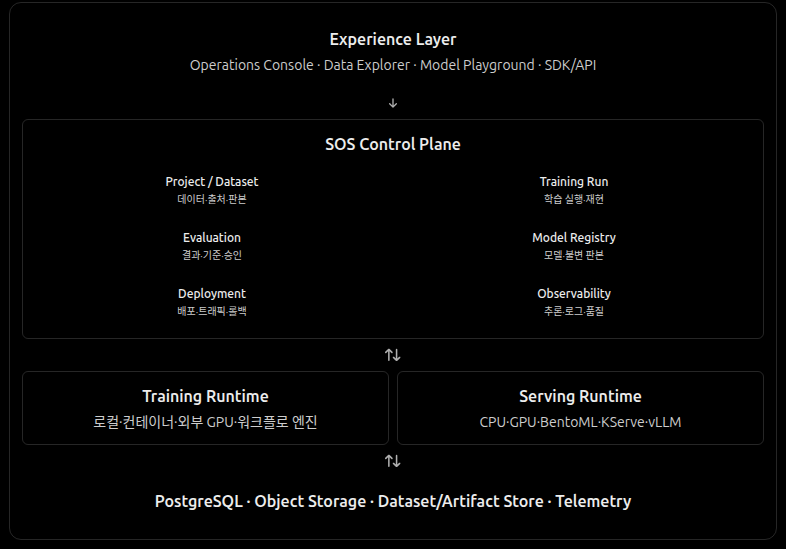
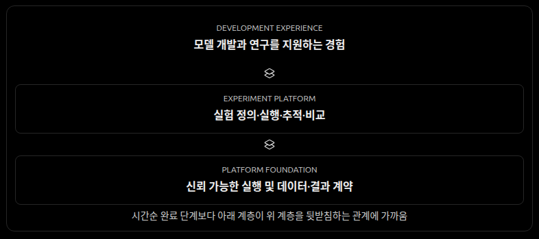

# 아키텍처

SOS는 **Research Platform · ML Execution Platform · ML Service Platform**의 능력을 공통 API로 연결한다. 논리적 책임을 구분하되 처음부터 별도 서버나 프로세스로 배포해야 한다는 뜻은 아니다.

## 논리적 구성

- **공통 API:** 사람·웹·외부 시스템·AI 에이전트에 동일한 신원·권한·요청·결과 계약을 제공한다.
- **Application / Control Plane:** SOS는 Dataset·Job/Attempt·정책·평가·모델의 불변 실행 참조 및 접근 권한을 관리한다. MLflow는 Experiment·Run·Registered Model/Version·Alias 관리 정본이다.
- **Execution Boundary:** Job 요청과 Runtime 요구를 실행기에 전달하고 시도·취소·결과·오류를 연결한다.
- **Training / Evaluation / Serving Runtime:** 실제 계산을 수행하며 프레임워크나 배치 엔진의 내부 형식이 공통 계약을 바꾸지 않도록 분리한다.
- **Data / Artifacts / Tracking:** 불변 결과와 그 참조 관계를 보관한다. 메타데이터, 원본 파일, 외부 추적은 각자 다른 정본을 가진다.

다이어그램은 장기 목표의 책임 경계를 나타낸다. 표시된 저장소·프레임워크와 아직 구현되지 않은 Serving 능력이 현재 필수 구성임을 의미하지 않는다. Data Explorer와 Model Playground도 같은 계약을 사용하는 경험이며 별도 플랫폼이 아니다.

계층은 기능 구현의 필수 완료 순서가 아니라 기반 계약과 그 위의 경험이 서로를 뒷받침하는 관계를 나타낸다.

## 변하지 않아야 할 경계

1. **API-first:** 클라이언트 종류에 따라 핵심 기능이나 권한 판정이 달라지지 않는다.
2. **제어와 실행 분리:** 오래 걸리는 계산을 API 요청 처리와 분리하고, 필요에 따라 단독 Job 또는 Workflow로 조합한다.
3. **도메인과 인프라 분리:** 모델·실험·Job의 의미를 특정 Worker·저장소·MLflow 객체에 종속시키지 않는다.
4. **실행 근거 추적:** 데이터·모델·설정·Runtime·Job/Attempt·평가·아티팩트의 참조 관계를 남긴다.
5. **권한과 신뢰 분리:** Actor의 데이터 권한과 외부 코드 실행·모델 복원·비밀정보 접근 권한을 혼동하지 않는다.
6. **점진적인 배치:** 로컬에서 시작하더라도 독립 Worker·Serving으로 확장할 때 공통 계약을 유지한다.

구체적인 판본과 호환성은 [Contracts](contracts.md), 사용자 행동은 [Experience](experience.md), 실행 상태는 [Workflows](workflows.md), 환경 격리는 [Runtimes](runtimes.md)가 정본이다.

## 현재 구현과 논리적 책임

현재 PostgreSQL은 Dataset·Job·Attempt 등 제어 메타데이터를, S3 호환 저장소는 데이터·결과 객체를, Iceberg Catalog는 테이블·Snapshot 상태를 담당한다. 이 저장소들은 하나의 원자적 트랜잭션을 공유하지 않는다. 객체 게시와 Snapshot 보존은 참조·의도·실제 외부 상태를 구별한다. 소유권 불명의 Iceberg 테이블은 읽기와 쓰기 권한을 혼동하지 않는다. 세부 보존·쓰기 규칙은 [Contracts](contracts.md)와 [ADR 0002](adr/0002-object-lifecycle.md)·[ADR 0008](adr/0008-iceberg-table-write-ownership.md)을 따른다.

현재 DuckDB는 Dataset 탐색·프로파일, Polars는 Feature·변환 연산을 수행한다. 데이터 이해 결과는 원본 판본과 연결하지만 Dataset 등록 자체를 바꾸지 않는다. 이들은 현행 어댑터의 선택이며, 다른 연산기나 실행기를 도입하더라도 Dataset·Job의 의미가 달라져서는 안 된다.

현재 서비스는 [Compose](../compose.yaml)로 로컬 실행한다. API·Worker·Web을 한 Compose 프로젝트에서 실행하는 것은 배포 방식이지 장기 아키텍처 정의가 아니다. 운영 절차는 [Getting Started](getting-started.md), 오류·복구는 [Diagnostics](diagnostics.md)를 따른다.
