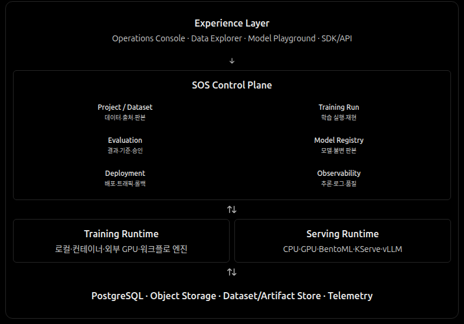
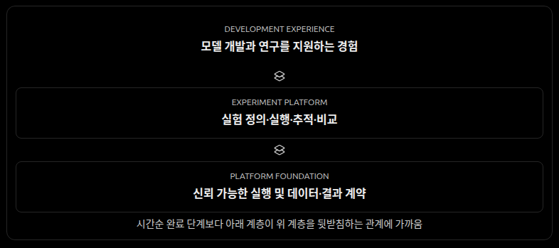

# 아키텍처

SOS는 **Research Platform · ML Execution Platform · ML Service Platform**의 능력을 공통 API로 연결한다. 논리적 책임을 구분하되 처음부터 별도 서버나 프로세스로 배포해야 한다는 뜻은 아니다.

## 논리적 구성

- **공통 API:** 사람·웹·외부 시스템·AI 에이전트에 동일한 신원·권한·요청·결과 계약을 제공한다.
- **Application / Control Plane:** SOS는 Dataset·Job/Attempt·정책·평가·모델의 불변 실행 참조 및 접근 권한을 관리한다. MLflow는 Experiment·Run과 생산 Pipeline이 등록한 원본 Registered Model/Version의 정본이다. 모델 그룹과 판본의 사용 허용은 SOS가 정한다([ADR 0025](adr/0025-sos-owned-model-use-decision.md)).
- **Feature Store:** 등록 Feature의 Entity·Feature View·Feature Service와 Point-in-Time Historical Retrieval은 Feast가 관리한다. SOS는 원본 Dataset·Snapshot·조회 Job·불변 결과·Actor 권한을 소유한다. Data Preparation과 직접 모델 입력은 독립 기능이다. [ADR 0018](adr/0018-feast-feature-ownership.md)을 따른다.
- **모델 생산:** 데이터 준비·학습·평가·MLflow 등록은 Dagster OSS의 생산 Pipeline이 직접 실행한다. 생산 Pipeline은 SOS DB·저장소에 접근하지 않고, 등록한 고정 모델 버전의 연결을 SOS API에 요청한다. SOS는 모델 패키지를 검증해 Model Revision으로 게시하고 이후 제공·적용·서빙·설명을 맡는다. SOS 안의 Dataset 학습은 독립 기능이다. [ADR 0024](adr/0024-model-production-realignment.md)를 따른다.
- **Online Serving:** Endpoint의 의도(서빙·중단, 활성·전환 대상·직전 판본)는 SOS가, 복제본 실행·라우팅은 Ray Serve가 맡는다. 독립 `serving-controller`가 실제 상태를 의도에 맞추고 준비가 확인된 판본으로만 전환한다. 외부 요청은 SOS API의 인증·권한·입력 검증을 거친다. [ADR 0019](adr/0019-ray-serve-online-serving.md)를 따른다.
- **Execution Boundary:** Job 요청과 Runtime 요구를 실행기에 전달하고 시도·취소·결과·오류를 연결한다.
- **Training / Evaluation / Serving Runtime:** 실제 계산을 수행하며 프레임워크나 배치 엔진의 내부 형식이 공통 계약을 바꾸지 않도록 분리한다.
- **Data / Artifacts / Tracking:** 불변 결과와 그 참조 관계를 보관한다. 메타데이터, 원본 파일, 외부 추적은 각자 다른 정본을 가진다.

다이어그램은 장기 목표의 책임 경계를 나타낸다. 표시된 저장소·프레임워크가 현재 필수 구성임을 의미하지 않는다. Data Explorer와 Model Playground도 같은 계약을 사용하는 경험이며 별도 플랫폼이 아니다.

계층은 기능 구현의 필수 완료 순서가 아니라 기반 계약과 그 위의 경험이 서로를 뒷받침하는 관계를 나타낸다.

## 변하지 않아야 할 경계

1. **API-first:** 클라이언트 종류에 따라 핵심 기능이나 권한 판정이 달라지지 않는다.
2. **제어와 실행 분리:** 오래 걸리는 계산을 API 요청 처리와 분리해 Job으로 실행한다.
3. **도메인과 인프라 분리:** 모델·실험·Job의 의미를 특정 Worker·저장소·MLflow 객체에 종속시키지 않는다.
4. **실행 근거 추적:** 데이터·모델·설정·Runtime·Job/Attempt·평가·아티팩트의 참조 관계를 남긴다.
5. **권한과 신뢰 분리:** Actor의 데이터 권한과 외부 코드 실행·모델 복원·비밀정보 접근 권한을 혼동하지 않는다.
6. **점진적인 배치:** 로컬에서 시작하더라도 독립 Worker·Serving으로 확장할 때 공통 계약을 유지한다.
7. **크기와 무관한 실행:** 데이터 크기에 따라 기능·처리 경로·계산 의미를 나누지 않는다. 데이터는 배치로 읽고, 전체 순서가 필요한 계산(분위수·순위 지표·정렬)은 외부 정렬과 디스크 Spill로 정확하게 계산한다. 실행 자원으로 수용할 수 없을 때만 자원 부족을 보고한다. 모델 적합처럼 알고리즘 자체가 요구하는 자원은 해당 Runtime의 실행 조건으로 다룬다.

구체적인 판본과 호환성은 [Contracts](contracts.md), 사용자 행동은 [Experience](experience.md), 실행 상태는 [Workflows](workflows.md), 환경 격리는 [Runtimes](runtimes.md)가 정본이다.

## 현재 구현과 논리적 책임

Job 저장소는 실행 소유권·Attempt·취소 판정과 종료 트랜잭션을 담당한다. 실행 결과 조합 계층이 결과 유형별 게시와 Tracking 전송 의도를 연결하고, 각 게시 함수는 자산 참조·감사를 같은 DB 연결에 기록한다. 게시 함수는 별도 트랜잭션이나 외부 SDK 호출을 시작하지 않는다. Worker는 자식 프로세스의 격리·예산·취소·소유권을 감독하고, 연산 실행과 Attempt 파일·게시 입력 준비는 실행 계층에 위임한다. Job 저장소에 모델·평가별 게시 인자를 전달하지 않는다.

현재 PostgreSQL은 Dataset·Job·Attempt 등 제어 메타데이터를, S3 호환 저장소는 데이터·결과 객체를, Iceberg Catalog는 테이블·Snapshot 상태를 담당한다. 이 저장소들은 하나의 원자적 트랜잭션을 공유하지 않는다. 객체 게시와 Snapshot 보존은 참조·의도·실제 외부 상태를 구별한다. 소유권 불명의 Iceberg 테이블은 읽기와 쓰기 권한을 혼동하지 않는다. 세부 보존·쓰기 규칙은 [Contracts](contracts.md)와 [ADR 0002](adr/0002-object-lifecycle.md)·[ADR 0008](adr/0008-iceberg-table-write-ownership.md)을 따른다.

현재 DuckDB는 Dataset 탐색·프로파일, Polars는 Feature·변환 연산을 수행한다. 데이터 이해 결과는 원본 판본과 연결하지만 Dataset 등록 자체를 바꾸지 않는다. 이들은 현행 어댑터의 선택이며, 다른 연산기나 실행기를 도입하더라도 Dataset·Job의 의미가 달라져서는 안 된다.

현재 서비스는 [Compose](../compose.yaml)로 로컬 실행한다. API·Worker·서빙·Web을 한 Compose 프로젝트에서 실행하는 것은 배포 방식이지 장기 아키텍처 정의가 아니다. 운영 절차는 [Getting Started](getting-started.md), 오류·복구는 [Diagnostics](diagnostics.md)를 따른다.
