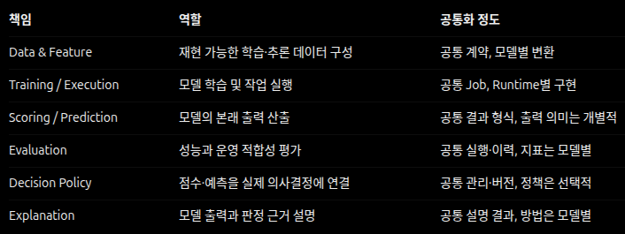

# 계약

플랫폼의 공통 개념과 컴포넌트 사이의 의미를 정의한다. **정확한 필드명·타입·기본값은 구현된 코드, 스키마 및 자동 생성된 API 명세**가 원본이며 여기서 복제하지 않는다. 계약은 특정 프레임워크나 서비스 제품의 내부 객체에 종속되지 않는다.

## 핵심 개념

| 개념 | 의미와 경계 |
| --- | --- |
| **Experiment** | 연구 목적에 따라 관련 설정·실행·평가를 비교하는 논리적 묶음 |
| **Workflow Definition** | 재사용 가능한 작업 단계, 입력·출력·의존관계의 정의 |
| **Workflow Run** | 특정 Workflow Definition을 실행한 개별 기록. 하나 이상의 Job을 포함할 수 있다 |
| **Job** | 플랫폼에 제출된 단일 실행 요청과 그 수명주기를 추적하는 논리적 단위 |
| **Execution Attempt** | Job을 수행한 실제 시도. 재시도는 이전 시도와 구분된다 |
| **Dataset Reference** | 사용된 데이터의 소스·버전 또는 재식별 가능한 범위와 스키마 |
| **Model Revision** | 식별 가능한 한 모델 결과의 불변 판본. 가변적인 배포 별칭과 구분한다 |
| **Artifact** | 모델·전처리·평가·로그 등 생성·참조되는 결과물과 무결성 정보 |
| **Evaluation** | 특정 모델·데이터·지표·평가 조건의 조합으로 얻은 결과 |
| **Runtime Specification** | 작업을 실행하는 데 필요한 환경 및 호환성 요구 |

데이터·모델·결과의 소유와 접근 범위는 Actor 단위다. [Platform Identity](vision/PLATFORM_IDENTITY.md)의 Project는 장기 개념이며 현재 영속 리소스나 권한 범위로 구현돼 있지 않다.

등록형 Pipeline의 Workflow 정의·단계 의존성·Run 상태·운영 Lineage는 Dagster OSS가 관리한다. SOS의 Workflow 제출 식별·Actor 권한과 개별 Job/Attempt·불변 결과는 SOS 정본이며, MLflow는 Experiment·Model Registry의 관리 정본이다. 이 세 시스템의 ID·책임을 동일한 상태나 자산으로 취급하지 않는다.

등록형 Pipeline은 개발 환경에서 정의해 배포한 신뢰된 Workflow Definition이다. 각 실행은 Dataset 판본에 고정된 별도 Workflow Run이며 기존 Job/Attempt·권한·불변 결과를 재사용한다. Pipeline을 이용하지 않는 독립 ML API 실행도 유지한다. 단순한 Job은 Workflow Definition에 속할 필요가 없다. 실험은 실행 자체가 아니며, Job과 실행 시도도 동일하지 않다. 모델 판본·아티팩트·배포 대상은 서로 다른 생명주기를 가진다.

모델 그룹은 목적별 논리적 Registered Model이며 그룹의 표시 이름·설명·보관과 모델 버전은 MLflow가 관리한다. 그룹을 지정하지 않은 모델은 `default` 그룹에 속한다. 새 학습으로 기존 고정 모델 결과를 덮어쓰지 않는다. Registry 그룹/버전 보관은 신규 모델 사용을 제한하지만 물리 삭제가 아니다. 모델 파일의 영구 삭제는 SOS가 실제 S3 객체와 MLflow 버전 제거를 확인하고 `Deleting`/`Deleted` 상태를 기록한다. 과거 Scoring·정책·평가·설명은 독립 실행 근거로 남고 삭제된 Model Revision은 접근 불가 모델 파일의 참조 tombstone이 된다. 결정 배경은 [ADR 0017](adr/0017-model-lifecycle.md)에 있다.

## 등록 Feature

Feast는 등록 Entity·Feature View·Feature Service와 Historical Retrieval의 정본이다. SOS는 Dataset 판본·Actor 권한·Job/Attempt·실제 게시한 조회 결과의 정본이다. 지속적 Entity Key와 Dataset 판본 내부의 `sos_observation_id`는 다르다. 결정 배경은 [ADR 0018](adr/0018-feast-feature-ownership.md)에 있다.

- **등록과 조회:** 별개 Job이다. 조회는 등록 Job이 고정한 Feature Service·Source 판본을 재사용하며 Registry에 새 정의를 게시하지 않는다. 조회 결과 Dataset은 출처 조회 Job을 기록하고 Entity 시점 Dataset의 `sos_observation_id`를 보존한다. 이를 학습한 Model Revision은 등록·조회 Job, Feature Service·정의 지문과 원본 Dataset 판본을 실행 근거로 고정한다.
- **외부 커밋:** Feast 커밋과 SOS Job 확정은 별개로 판단한다. 재시도는 같은 정의만 재조정하며 Registry 내용이 불일치하거나 소실되면 조회를 거부한다.
- **폐기:** 독립 Job이며 같은 등록의 조회·폐기 접수를 직렬화한다. 폐기 접수 이후 신규 조회는 거부하되 이미 접수한 조회는 완료할 수 있다. Registry 삭제가 시작된 폐기는 취소하지 않으며, 외부 삭제가 실패하면 재조정 전까지 신규 조회를 차단한다. 실패한 폐기는 새 폐기 Job으로 재시도한다.
- **보존:** 과거 조회나 다른 활성 등록이 참조하는 Registry 객체와 과거 조회 Dataset·모델 판본은 유지한다. 이 참조가 Registry의 현재 상태나 데이터의 물리적 보존을 대신하지 않는다.

## ML 점수·판정·평가의 독립성

- **Scoring 입력:** Scoring 제출은 고정된 Dataset 판본의 Feature 이름·수치형·모델에 기록된 Feature별 자료형을 접수 전에 검사하고, 불일치하면 원인 컬럼과 함께 거부한다. Worker는 같은 규칙과 값·결측 조건을 다시 검증한다.
- **Scoring 근거:** 학습에 사용한 Dataset 판본을 점수화한 결과는 독립 검증 성능이 아니다. 학습 시 고정한 UTC 시간 경계로 선택한 Calibration/Test 범위는 원본 판본·구간·행 수를 결과 근거로 보존한다. 결과의 `row_index`는 결과 내부 순서이며 원본 관측치 식별자가 아니다. 시간 구간의 비중복과 관측값 간 통계적 독립성은 다르다.
- **관측 시각과 관측치 ID:** 명시적으로 지정한 원본 시간 컬럼은 UTC로 검증해 결과 행에 보존한다. **시간 보존은 시간 분할이나 독립 Test 검증이 아니며** 관측 시각은 고유 ID가 아니다. 관측치 연결에는 원본에 미리 고정한 불투명 UUIDv4 `sos_observation_id`만 사용하고 점수화 범위 안의 형식·고유성을 검증한다. 업무 식별자에서 자동 파생하거나 원본 접근 권한을 대신하지 않는다. Transform Job이 발급한 UUID는 게시된 Dataset 판본 안에서만 안정적이므로 재현에는 그 판본을 고정한다. 과거 결과에 없는 근거는 임의로 연결하지 않으며, 집계 Feature 관측치는 원시 이벤트 한 건을 보장하지 않는다.
- **모델 점수와 판정:** 학습된 모델의 점수는 확률·참값이 아니다. 점수 방향·척도·모델 판본을 표시하며, 점수를 임계값과 운영 행동으로 바꾸는 정책은 별도로 판본 관리한다. 정책의 보정 Scoring Result와 정책을 적용하는 Scoring Result는 서로 다른 참조일 수 있다. 재사용은 동일 모델 판본·Feature 서명·점수 방향과 척도 및 각 결과에 대한 접근 권한을 검증한 뒤 허용한다. Scoring Result ID가 다르다는 사실만으로 데이터 구간의 비중복·독립성을 입증하지 않는다.
- **레이블과 평가:** 비지도 학습이라는 사실과 평가 레이블의 존재 여부를 구별한다. 레이블 없는 결과에 정답 기반 정확도·Precision·Recall을 붙이지 않는다. 레이블이 불충분한 경우 근거 수준과 미정의 지표를 구별한다. 정책이 없더라도 레이블이 있으면 순위 지표만 평가할 수 있으며, 이를 무레이블 평가로 표시하지 않는다. 같은 Scoring Result의 점수로 산정한 분위수 임계값은 별도 보정·검증 집합에 근거한 독립 성능을 뜻하지 않는다.
- **학습 입력과 실행 자원:** `all`은 선택한 Train 범위의 모든 행, `sample`은 명시적으로 선택한 행 수를 의미하며 실제 데이터 저장 방식이나 Worker의 RSS/임시 디스크 예산과 혼동하지 않는다. 물리적으로 수용할 수 없을 때는 실행 실패를 정확히 보고하지만, 임의의 사전 행 수 상한에 맞추려고 입력을 조용히 줄이지 않는다.
- **Explanation 출력 경계:** Feature 치환 민감도와 Permutation SHAP 기여도는 서로 다른 설명 방법이다. SHAP은 모델의 실제 SOS 점수 함수(전처리 포함)·기준 출력을 설명하며, 기준값·선택된 배경·Seed·평가량·라이브러리 판본·가법 재구성 오차를 결과에 남긴다. 단일 Train 중앙값 합성 배경은 Train 관측 분포를 대표하지 않으며, 기여도는 사고 원인·확률·정답을 의미하지 않는다.
- **단계 재사용:** 이미 계산된 모델 점수를 다른 Threshold Policy에 적용하거나 설명을 별도로 생성할 때 불필요하게 다시 학습하지 않는다. 실제 재사용 가능 범위는 입력·모델·방법·Runtime 계약으로 판단한다.
- **MLflow 관리 정본:** Experiment·Run·Registered Model·Model Version의 관리 정본은 MLflow다. SOS의 Model Revision은 Job/Attempt·Dataset·아티팩트 SHA·Feature·Runtime의 불변 실행 참조이며 MLflow 고정 버전을 연결한다. 등록되지 않은 신규 모델은 Scoring에 사용할 수 없다. Job/Attempt와 Evaluation의 결과 의미는 MLflow가 대체하지 않는다.

Dataset 없는 단일 관측치 Playground Job은 입력 Feature와 실제 모델 점수를 Job 명세·결과로 보존한다. Explanation의 출처는 Scoring Result의 특정 행 또는 성공한 Playground Job 중 정확히 하나이며, 출처·모델 판본·방법을 결과에 보존하고 Dataset에 존재하지 않는 관측치 번호를 만들지 않는다. Playground는 배치 Scoring Result나 독립 평가를 만들지 않으며 모델 판본·Actor 권한·Registry·입력 서명·Runtime을 Scoring과 같이 검증한다.

## 온라인 서빙 Endpoint

- **의도와 실제 상태:** Endpoint는 소유 Actor 안에서 고유한 이름, 서빙·중단 의도, 활성·전환 대상·직전 판본을 가진다. 실제 실행 상태(실행 중·준비 중·배포 실패 등)는 서빙 Runtime에서 조회해 응답하며 저장하지 않는다. `ready`는 서빙 의도이고 활성 판본이 의도한 Config로 실제 실행 중일 때만 참이다. 이름이 같아도 서빙 Runtime에 적용된 Config가 의도와 다르면 그 애플리케이션은 `OUT_OF_SYNC`이며 컨트롤러가 의도로 되돌린다. 소유자·관리자는 `status_reason`으로 실패 원인이나 자원을 기다리는 이유를 본다.
- **판본 전환:** 새 판본은 전환 대상으로 준비되고, 서빙 Runtime의 실제 복제본이 그 판본과 설정으로 시작된 것을 확인한 뒤에만 활성 판본이 된다. 그 전과 실패 시에는 기존 활성 판본이 요청을 처리한다. 되돌리기는 직전 판본을 같은 방식으로 다시 준비한다. 전환 취소는 기존 활성 판본이 있을 때만 가능하다. 서빙 대상은 Registry 등록이 확인된 활성 판본이다.
- **자원 수용:** 판본마다 복제본 하나를 두며, 전환 중에는 전환 대상도 복제본 하나를 차지한다. 생성·전환·되돌리기·재개는 변경 뒤 필요한 복제본 수가 서빙 Runtime의 실제 CPU로 실행할 수 있는 수를 넘으면 필요한 수와 실행 가능한 수를 밝혀 409로 거절한다. 수용량을 확인할 수 없으면 `SOS-SERVING-UNAVAILABLE`로 거절한다. 중단·전환 취소·삭제는 언제나 받는다. 이 판정은 CPU 예약 기준의 접수 제한이며 메모리나 다른 Ray 작업의 점유까지 보장하지 않으므로, 접수된 뒤 자원을 기다리는 판본은 `status_reason`으로 이유를 보인다.
- **추론 계약:** `POST /api/serving/endpoints/{id}/predict`는 `inputs`에 관측값 1~100건을 Feature 이름별 객체로 받고, 모델 입력 서명(이름·자료형)을 Playground와 같은 규칙으로 검증한다. 결측은 `null`이다. 응답은 `model_revision_id`, 판본에 기록된 `output_type`과 점수 방향·척도, 그 출력 종류의 구조를 따르는 입력 순서대로의 `outputs`를 준다(`anomaly_score_v1`은 `outputs[i].anomaly_score`). 서빙 Runtime이 만들지 않는 출력 종류의 판본은 복제본이 시작되지 않아 배포 실패로 보고되며, SOS API는 판본에 기록된 출력 계약(종류·점수 방향·척도)이나 결과 구조와 맞지 않는 응답을 서빙 장애(`SOS-SERVING-UNAVAILABLE`)로 처리하고 전달하지 않는다. 같은 판본에 같은 입력을 보내면 Playground·Scoring과 같은 점수다. 추론 요청은 Job·결과로 저장하지 않는다.
- **접근:** 추론은 `model.infer` 권한이 필요하다(viewer 제외). 소유자·관리자가 아니면 활성 판본이 지금 제공 중이고 서빙 의도인 Endpoint만 조회·호출하며, 전환 대상·직전 판본과 실패 사유는 보지 않는다. 전환·되돌리기·취소·중단·재개·삭제는 소유자 또는 관리자(`model.manage`)만 하며 감사 기록에 남는다. 응답의 `owned`는 호출 계정의 소유 여부, `manageable`은 관리 가능 여부이며 소유 계정(`owner_actor`)은 관리할 수 있는 사용자에게만 보인다. Endpoint 이름은 계정 안에서만 고유하므로 자동화는 소유 계정과 Endpoint ID로 대상을 식별한다.
- **Registry 상태:** 추론과 Endpoint 생성·전환·되돌리기는 Playground·Scoring과 같은 Registry 검증(보관 여부·출처·SHA-256)을 통과한 판본만 쓴다. 확인 성공은 최대 30초 재사용하므로 모델 버전·그룹의 보관은 그 안에 추론에 반영된다. MLflow 장애로 확인할 수 없으면 다른 새 사용과 같이 503으로 거절하며, 서빙 Runtime은 계속 실행되어 MLflow가 복구되면 바로 다시 응답한다.
- **수명주기:** Endpoint는 중단한 뒤에만 삭제한다. 어떤 Endpoint의 활성·전환 대상·직전 판본으로 참조되는 모델은 영구 삭제할 수 없다. 모델 제공 중단은 다른 Actor의 호출을 즉시 막지만 소유자의 서빙은 유지한다.
- **오류:** 서빙 의도가 아니거나 활성 판본이 아직 실행 중이 아니면 `SOS-SERVING-NOT-READY`(409), 서빙 Runtime에 연결할 수 없거나 응답 시간이 초과되면 `SOS-SERVING-UNAVAILABLE`이다. 둘 다 상태를 다시 조회한 뒤 재시도한다.

## 분석 주제

- **주제 계약:** 분석 주제는 식별자, 학습 유형·분석 과제 분류, 입력 Feature, 출력 계약(`output_type`)을 가진다(`GET /api/topics`). 등록 Pipeline은 주제에 모델을 공급하는 선택적 Workflow이며 정의의 `topic`으로 주제를 가리킨다.
- **적합성:** 모델은 입력 Feature 이름 집합과 `output_type`이 주제와 같으면 그 주제에 맞는다. 알고리즘과 공급 Pipeline은 판정에 쓰지 않으며 입력 순서도 비교하지 않는다. 같은 `output_type`이라도 점수 척도는 알고리즘마다 다를 수 있으므로 점수는 같은 판본끼리 비교한다.
- **출력 계약:** 판본은 학습할 때 출력 계약(`output_type`·점수 방향·척도)을 Runtime 기록에 남기고, 모델 응답과 Scoring·Playground·온라인 추론·설명은 그 기록을 따른다. 같은 알고리즘의 출력이 나중에 바뀌어도 기존 판본의 의미는 바뀌지 않는다. 기록 이전에 학습된 판본은 당시 알고리즘의 출력을 따른다. 현재 `isolation_forest`는 관측마다 이상 점수 하나(`anomaly_score_v1`, 높을수록 이상)를 낸다.

## ML 기능별 책임과 공통화 경계

표의 공통화 정도는 모든 모델·방법에 같은 연산, 출력 형태, 지표 또는 설명 기법을 강제한다는 의미가 아니다. 영역마다 식별·출처·판본·권한·실행·결과·감사와 같은 플랫폼 계약을 공유하되, 실제 지원 능력과 입력·출력 의미는 모델과 방법에 따라 명시한다. Scoring/Prediction의 점수 의미, Evaluation의 지표, Decision Policy의 적용 여부, Explanation의 방법과 해석은 서로 독립적으로 검증하며 **특정 기능을 모든 모델의 필수 단계로 가정하지 않는다**.

## 모든 경계에서 지킬 규칙

- **식별과 연결:** 요청, 실행 시도, 입력 데이터, 모델 판본, 평가, 아티팩트와 Runtime을 안정적 식별자·참조로 연결한다.
- **결과의 보존:** 이미 생성된 모델 판본·평가 결과·아티팩트의 의미를 조용히 덮어쓰지 않는다. 재실행과 재평가는 새로운 기록으로 남긴다.
- **입출력 명시:** 데이터·모델 계약에서 형태(Shape), dtype, 컬럼, 시간 기준·타임존, 결측 및 값의 단위를 필요한 범위에서 표현하고 검증한다.
- **작업 의미:** 접수, 상태, 취소, 재시도, 오류의 의미는 [Workflows](workflows.md)와 일치해야 한다. 외부 API에서 중복 제출의 위험이 있는 작업은 멱등성 정책과 그 범위를 명확히 한다.
- **오류와 접근:** 기계 판독 가능한 오류 종류와 사용자 친화적 설명을 구분한다. 외부 시스템·에이전트도 동일한 권한·검증 규칙을 따른다.
- **호환성:** 후방 호환 가능한 확장과 호환성을 깨는 변경을 구분한다. 호환되지 않는 변경은 명시적 계약 식별 또는 마이그레이션 경로 없이 조용히 적용하지 않는다. 단, 사용자가 없고 외부 호출자가 존재하지 않는 사전 출시 단계에서는 명시적으로 승인한 구형 계약을 제거하고 코드·UI·테스트를 일괄 전환할 수 있다. 이 정책은 프로젝트 버전 `0.0.1`과 별개다.
- **Runtime 독립성:** 프레임워크가 다르다는 이유만으로 공통 플랫폼 계약의 의미가 바뀌지 않는다. 다만 모델 파일이 모든 Runtime에서 읽힌다고 약속하지 않으며 호환성을 명시적으로 검증한다.

## 권한과 표시 설정

- 사용자 화면의 기능 가시성은 인증 API에서 서버 역할 정책으로 계산한 `capabilities`를 사용한다. UI 제어는 편의 기능이며 서버의 Action 검사가 최종 권한 정본이다. 기록 조회와 실행 제출은 독립적이며 데이터·모델 소유권 검사는 역할과 별개로 적용한다.
- 모델 학습·Fork·학습 포함 Workflow와 모델·Feature 정의 변경 권한은 일반 Job 실행 권한에 포함되지 않는다. 이 권한은 `kind: service` Actor에만 부여할 수 있는 `automation` 역할과 관리자에게만 있다.
- 다른 Actor의 모델 판본은 그 모델을 소유한 자동화 계정이나 관리자(`model.manage`)가 목적·적용 대상·한계 설명과 함께 명시적으로 제공한 경우에만 조회·적용한다. 소유자와 관리자는 제공 전 판본도 적용할 수 있다. 제공은 판본 조회와 새 Scoring·단일 입력 계산·설명 제출, 그 판본을 활성 판본으로 둔 Endpoint의 온라인 추론만 허용하며 학습 Dataset·학습 Job·실험 기록의 소유권 검사를 완화하지 않는다. 결과는 실행한 Actor가 소유한다. 제공 중단은 새 모델 적용만 막고 이미 만든 결과와 판본 설명 조회는 유지하며, 제공·중단은 감사 기록에 남긴다. 제공 중인 판본의 물리 삭제는 먼저 제공 중단을 요구한다. 제공·중단·새 적용 접수·삭제 전환은 같은 모델 행 잠금으로 직렬화한다.
- 제품 브랜드명(`brand_name`)과 인스턴스 표시명(`display_name`)은 설치 인스턴스의 표시 설정이다. 로그인 전에는 브랜드명만 공개 조회할 수 있고, 변경은 `instance.configure` 권한과 감사를 따른다. 두 값은 인증 모드·배포 환경 의미를 갖지 않으며 내부 패키지·API 식별자·환경변수·오류 코드 및 데이터·모델 식별자와 독립적이다. 인증 모드는 `/api/v2/auth/me`가 정본이다.

## 데이터 해석과 분석 범위

- **입력 해석:** 파일 원본의 바이트 무결성과 Dataset의 입력 해석 설정은 다른 개념이다. 같은 원본 바이트라도 헤더 유무 등 해석 조건에 따라 다른 Dataset 참조를 만들 수 있으며, 등록 시 확정한 해석은 Preview·Profile·Worker·Feature 계산에 일관되게 적용한다. 구분자·헤더·인코딩을 추측하거나 복구하지 않고, 탐색 엔진과 Worker가 서로 다른 컬럼·행으로 해석할 수 있는 입력은 등록 단계에서 거절한다. 지원 형식과 오류는 API 구현이 정본이다.
- **Understanding:** 특정 원본 판본과 프로파일 알고리즘·분석 범위에 대한 불변 결과다. 재계산은 기존 결과를 덮어쓰지 않으며 분석의 실패·취소가 원본 등록을 바꾸지 않는다. 컬럼의 역할은 근거가 있는 후보이며 확인되지 않은 업무 의미나 Target으로 확정하지 않는다.
- **탐색 후보:** 업무 목적에 대한 권고가 아니라 입력 데이터 특성으로 구성한 실행 가능한 탐색 조건이다. 선택해도 계산하지 않으며, 사용자가 편집해 직접 작성한 조건과 동일한 API로 실행한다. 탐색 초안은 Dataset 판본에 귀속하며 다른 Dataset의 결과와 섞지 않는다. 전체 분석은 Job으로 별도 제출한다.
- **분석 범위와 근거:** 미리보기의 행 수 제한, 부분 데이터 분석의 선택 방식, 전체 데이터 분석의 입력 범위는 서로 다른 의미다. 결과 근거는 원본 판본, 입력 범위와 선택 방식, 요청 한도와 실제 분석 행 수, 지표별 정확·근사 계산, 반환·표시 제한으로 구분한다. 제한 조회를 대표 표본이나 원본의 첫 N행으로 표현하지 않으며, **전체 데이터 분석이 모든 통계값의 정확성을 뜻하지 않는다.** 응답에 없는 근거는 UI가 추정해 채우지 않고 0이나 정확한 값으로 대체하지 않는다. 선택 방식이 바뀌어도 과거 결과의 근거를 재해석하지 않도록 실행 시점의 방식·설정·알고리즘 판본을 결과에 결부한다.

## 데이터·실행에 적용하는 계약

- **Dataset:** 파일은 검증된 내용 무결성으로, Iceberg Dataset은 고정 Snapshot으로 입력 판본을 식별한다. 합성 예제도 실제 Dataset 참조를 사용하며 조용히 등록하지 않는다.
- **Discovery:** 미리보기와 전체 Job 분석의 입력 범위·반환 한계를 구별한다. NaN·Infinity와 실제 NULL, 큰 정수·DECIMAL의 정밀도, 바이너리·시간 값은 의미를 잃지 않도록 표현한다. 비유한 집계는 그룹 정렬·제한 이전에 정규화한다.
- **Feature:** Lag·Rolling의 시간 정렬·그룹 경계와 계산 범위를 보존한다. 동기 미리보기에서 전역 연산을 잘린 입력으로 대체하지 않으며, 위험한 임의 SQL·파일 경로를 쿼리 입력으로 받지 않는다.
- **Job 제출:** 외부 중복 요청이 위험한 작업은 Actor·명세·멱등성 키의 범위를 지킨다. 실행 중 외부 커밋이 불명확한 Iceberg 적재는 자동 재시도하지 않는다. [Workflows](workflows.md)가 실행 상태를 정의한다.
- **OpenAPI:** 서버의 Pydantic 모델과 생성 OpenAPI를 웹 타입의 정본으로 삼는다.

## Iceberg 테이블 쓰기 권한

- 테이블에 대한 쓰기 권한은 `datasets.owner_actor`로 표현되는 Snapshot 읽기·연결 권한과 독립적이다. 신규 테이블명 예약은 Job 멱등성 확인과 동일 PostgreSQL 트랜잭션으로 확정하여, 실패한 중복 요청이 다른 이름을 선점하지 않도록 한다.
- 신규 테이블은 PostgreSQL의 고유 이름·소유 Actor·무작위 토큰을 먼저 예약하고 실제 Iceberg Catalog Table Properties의 동일 토큰과 물리 Table UUID를 고정·검증한다. 같은 이름·토큰으로 다시 생성된 다른 UUID의 테이블은 기존 소유권을 재사용하지 못한다. 다른 Actor의 이름 충돌은 거부한다.
- API 제출 및 Worker 외부 커밋 이전의 실제 Table 메타데이터를 모두 검증한다. 미확정·소유권 불명·토큰 불일치·소실된 기존 테이블에는 쓰기를 허용하지 않는다. 기존 Snapshot 참조와 Tag는 그대로 유지한다.
- 테이블 쓰기 소유권은 한 Actor에게 귀속하며, administrator의 조회 권한을 자동 append 허가로 해석하지 않는다. 쓰기 토큰이 없거나 소유권이 불확실한 테이블은 읽기·보존만 허용하며, 관리자에게도 소유권 채택·이전 권한을 제공하지 않는다. 추가 적재가 필요하면 권한이 확인된 Dataset을 입력으로 신규 테이블명에 별도 적재해 새로운 소유권을 확정한다.

## Actor·보존 참조 계약

인증 제공자가 달라져도 검증된 Actor·Action·Resource에 대한 접근 판단 의미는 유지한다. 소유자가 기록되지 않은 데이터의 최초 접근자가 자동 소유자가 되지 않는다. Iceberg Dataset의 Snapshot ID는 읽을 판본을 식별하며, 실제 보존 상태는 Catalog에서 Tag 참조와 만료 정책을 재확인해야 한다. 보존되지 않은 과거 Snapshot은 사용 가능과 보존 보장을 혼동하지 않는다. 자세한 운영 결정은 [ADR 0003](adr/0003-snapshot-identity-audit.md)을 따른다.
