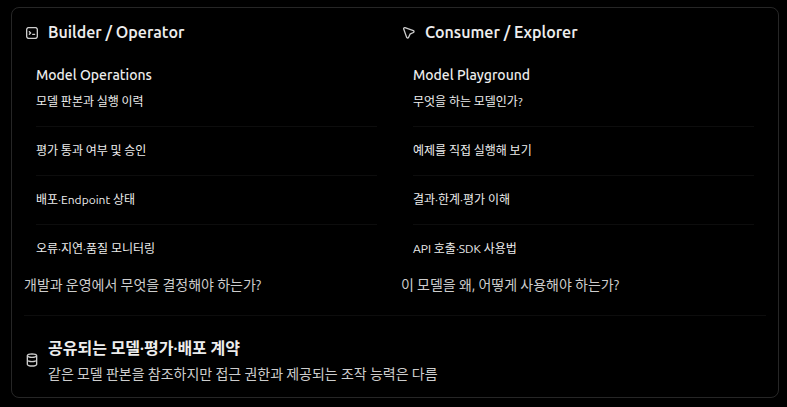
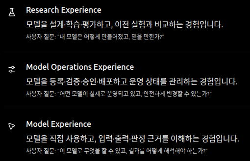
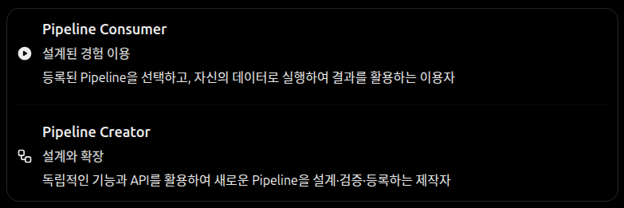

# 사용자 경험

사용자 경험은 화면을 만드는 마지막 단계가 아니라, 기능의 경계·상태·API 계약을 결정하는 설계 입력이다. 기능은 사용자 목표와 성공 기준을 먼저 이해하고 UX, 계약, 구현, 검증을 반복해서 맞춘다. [제품 정체성](vision/PLATFORM_IDENTITY.md)의 Fork·Compare·Reproduce·Understand·Explore·Apply는 연구 경험의 기준이다.

## 이용자별 경험

Builder / Operator는 모델·실행·평가·배포를 관리하고, Consumer / Explorer는 모델의 목적·제약·입출력을 확인하고 체험한다. 이는 고정된 계정 유형이 아닌 **사용 목적과 권한에 따른 경험의 차이**이며 한 사람도 두 경험을 모두 사용할 수 있다. 두 경험은 동일한 모델 판본과 평가 근거를 참조하지만 허용된 조작과 노출 정보는 다르다.

| 이용자 | 핵심 경험 |
| --- | --- |
| **Human** | 데이터 탐색·모델 개발·평가·배포 운영 또는 모델 소개·Playground·API 체험을 목적과 권한에 맞게 활용한다. 기술적 세부 정보는 필요할 때 단계적으로 제공한다. |
| **External System** | 명확한 요청·응답, 비동기 작업 식별, 상태 조회, 구조화된 오류, 중복 요청 처리와 예측 가능한 호환성에 기반해 연동한다. |
| **AI Agent** | 사람이 쓰는 핵심 기능을 공통 API·도구 계약으로 발견하고 사용할 수 있어야 한다. 작업의 권한과 부작용, 상태, 결과를 기계적으로 판독할 수 있어야 한다. |

웹 UI는 공통 플랫폼 기능을 활용한다. 특정 화면만 사용할 수 있는 숨겨진 핵심 기능이나 UI에 종속된 실행 계약을 만들지 않는다. API-first가 웹 사용성의 대체물은 아니다.

## 모델 실험실의 활동 이상 탐지 경험

등록된 Pipeline의 학습 유형·분석 과제·주제는 독립적인 분류 축이며 실제 제공되는 주제만 안내한다. 탐색 화면의 폴더 계층은 이러한 독립 속성으로부터 만들어지는 표시 방식이며 영속적인 분류 종속 관계가 아니다. 사용자는 등록된 예제 Pipeline을 바로 실행할 수 있고, 방법·입력 제약은 필요할 때 펼쳐 확인한다. 완료된 모델은 독립 Scoring Job으로 다른 Dataset에 적용할 수 있다. 패널을 접어도 같은 분석 내 작업 상태를 유지하며, 결과 판본에서 실제 점수순 관측치와 선택적 설명을 탐구한다. 판정 정책 없는 Scoring 순위는 확정된 이상 후보나 검증 성능이 아니다.

등록된 주제는 학습 유형·분석 과제·적용 주제를 별도 분류 차원으로 표시한다. 첫 제공 주제는 '비지도 학습 / 이상 탐지 / 활동 이상 탐지'이며 아직 제공하지 않는 분류를 빈 탐색 화면으로 노출하지 않는다. 학습 완료 후에는 Model Revision을 재학습하지 않고 호환 Dataset에 점수화하는 '모델 사용해보기'를 선택할 수 있다. Dataset 필수 Feature 이름을 확인하되 실제 자료형·실행 제약은 Scoring Job에서 최종 검증하며, 원래 Pipeline Test 결과는 변경하지 않는다. 모델 Playground는 등록 모델의 입력 Feature를 직접 수정하고 Dataset 등록 없는 별도 Worker Job으로 소량 점수화한다. 입력값은 Job 명세에 보존되며 같은 모델의 실행 이력을 조회해 실제 점수·입력값을 다시 확인하고 비교한다. Dataset Scoring Result 및 판정 정책과 혼동하지 않는다.

사용자는 설명이나 별도 예제 탐색을 거치지 않고 준비된 합성 예제로 모델 학습을 명시적으로 시작할 수 있으며, 실제 진행 상황과 학습·판정·Test 결과 및 후보를 이어서 확인한다. 예제 등록·입력 검사는 학습 요청의 일부이지만 명시적 사용자 행동 없이 실행하지 않는다. 처음부터 자신의 데이터를 선택하는 독립 경로도 지원하며, 자신의 데이터 사용은 첫 경험의 필수 조건이 아니다.

학습 과정과 모델의 점수 반응을 실제 근거로 표시한다. Isolation Forest에 존재하지 않는 epoch별 학습 곡선이나 정확도를 생성하지 않으며, MLflow 등록 대기와 학습 실패를 구분한다. 결과 탐구는 내부 Pipeline 단계별 클릭 순서로 강제하지 않고, 점수 분포·판정 기준·후보 Feature 민감도를 한 문맥에서 확인하도록 구성한다. Test 점수 분포의 구간을 선택하면 마지막 구간만 오른쪽 경계를 포함하는 히스토그램 정의에 따라 현재 불러온 후보 목록을 표시상 필터링하며, 전체 후보 수나 실제 판정 정책이 바뀐 것처럼 보여주지 않는다. 새 시간 분할 Scoring 결과의 관측 시각을 같은 결과 행에 보존한다. 사용자가 Dataset에 고정한 `sos_observation_id` UUIDv4가 형식·고유성 검증을 통과한 경우에만 관측치 ID를 함께 연결하며, UUIDv4 형식만으로 개인정보 비식별성을 보장하지 않는다.  과거 결과에 없던 값은 추정하지 않는다. 선택한 후보에서 실제 Feature와 Train 참조 중앙값을 비교하되 이 차이를 이상 사건의 원인·기여도로 단정하지 않는다. 선택적으로 동일 SOS 이상 점수 출력에 대한 Permutation SHAP을 계산해 기준 점수와 Feature 기여도 합·실제 점수의 일치를 확인한다. SHAP의 단일 Train 중앙값 합성 배경은 실제 Train 분포 대표가 아니며 기여도는 사고 원인·인과효과가 아니다. 기존 Feature 치환 민감도와 서로 다른 방법으로 표시한다. 원본 로그의 단일 이벤트와 집계 Feature 관측치도 구별한다. 직접 URL로 선택한 후보가 첫 페이지에 없어도 후보 번호로 조회할 수 있다.

모델 실험실의 주제 진입은 모델의 목적과 활동 변화 개념을 보여주는 홈으로 제공한다. 여기에서 등록 모델을 이용한 Scoring과 새 모델 학습을 독립된 행동으로 선택하며, 사용 가능한 모델이 없으면 새 학습을 주요 다음 행동으로 제공하고, 조회 실패나 남은 Registry 페이지를 실제 빈 목록과 구별한다. 예제·모델을 서버 시작 시 자동 등록하거나 학습하지 않는다. 실행 결과를 연 경우 학습 소개를 반복하지 않고 검증된 결과 요약과 후보 탐구를 우선 배치하며, 전체 분포·Feature 값·기술 근거는 필요할 때 펼쳐 확인한다. 선택 후보의 SHAP은 모델 기여의 방향과 기준값을 읽을 수 있는 너비·대비·레이블을 사용하고, 실제 점수·임계값은 축의 축약 표시와 별도로 보존한다. 과거 분석 목록과 실행 선택은 모델 실험실에서 제공하지 않고 작업 이력에서 조회한다. 홈의 최근 분석, 이력 목록, 결과 직접 URL은 각각 선택한 분석 결과로 바로 연결한다. 분석 결과에서 데이터를 확인하러 이동했다면 그 분석과 선택 후보·분석 구간의 복귀 문맥을 유지한다.

사용자 화면의 주요 이름은 '모델 실험실 > 활동 이상 탐지'와 '모델 학습 / 학습 결과 / 이상 후보 / 다른 데이터에 적용'으로 통일한다. Job·Run·Registry 식별자는 기술 근거가 필요할 때만 노출한다.

## 등록형 Pipeline 경험

**Pipeline Consumer(이용자)**는 등록된 분석·학습·평가 방법의 목적과 지원 데이터 계약을 확인하고 자신의 Dataset을 연결한다. 입력 적합성을 확인해 명시적으로 실행한 뒤 Run 상태·오류·결과를 이해하고 활용한다. 미리 설계된 방법을 이용하는 경험이지, 모든 내부 ML 설정을 사용자가 직접 구성해야 한다는 뜻은 아니다.

**Pipeline Creator(제작자)**는 독립적인 ML 기능과 공통 API를 활용해 새로운 방법을 설계·검증하고 필요할 때 재사용 가능한 Pipeline으로 등록한다. 연구·실험이 항상 Pipeline 등록으로 끝나는 것은 아니며 외부 연구 환경과 독립 기능을 사용할 수 있다. Consumer와 Creator는 고정된 계정 유형이나 상호 배타적인 역할이 아니라 이용 목적에 따른 경험의 구분이다.

첫 참조 Pipeline은 활동 Feature의 이름·자료형과 UTC 시간을 요구하며 서로 다른 사용자 데이터로 새 모델을 학습한다. 입력 오류를 무단 보정하지 않고 원본 데이터와 타인의 결과를 공유하지 않는다. 다른 연구·학습·Scoring 기능은 Pipeline 없이도 실행할 수 있다. 이 경험의 장기 개념적 책임 관계는 [Platform Identity](vision/PLATFORM_IDENTITY.md#pipeline-경험과-공통-실행-경계)를 따른다.

## 연구·실행의 목표 경험

1. **탐색:** 이용 가능한 데이터, 입력 스키마, 품질·시간 범위 및 제약을 이해한다.
2. **준비:** 모델과 평가 방법을 선택하고 기본 설정으로 시작하되, 필요 시 고급 설정을 조정한다. 실행 전 입력과 설정의 오류를 확인한다.
3. **실행:** 작업을 제출하고 식별자를 얻어 실제 상태와 진행 단계를 확인한다. 측정 불가능한 진행률을 추측해 표시하지 않는다.
4. **이해:** 결과와 지표, 실패 이유, 사용된 데이터·설정·모델·Runtime의 관계를 확인한다.
5. **발전:** 이전 실험과 비교하고, 재현하거나 분기해 새로운 실험을 수행하며, 모델을 추론·외부 서비스에서 재사용한다.

이 과정은 연구·실행 경험의 한 예시이지, 모든 실험에 강제되는 단일 화면이나 순서가 아니다. 연구자는 탐색·평가·추론 등 필요한 단계만 독립적으로 수행할 수 있다.

## 상호작용의 원칙

- **상태와 제어:** 접수·대기·실행·완료·실패·취소 상태의 의미는 [Workflows](workflows.md)를 따른다. 취소 요청을 즉시 취소 완료로 표시하지 않는다.
- **실패와 복구:** 입력 오류, 권한 문제, Runtime 불일치, 작업 실행 실패를 구분하고 가능한 다음 행동을 제시한다. 원인 불명일 때 성공처럼 표현하지 않는다.
- **결과의 신뢰:** 평가 지표에는 비교 조건·데이터 기준·제약을 함께 제공한다. 성공한 실행뿐 아니라 실패 기록도 후속 연구에 활용할 수 있게 한다.
- **조작 가능성:** 핵심 흐름은 명료한 명칭, 접근 가능한 피드백과 예측 가능한 상호작용으로 제공한다. 과도한 인프라 설정을 첫 사용의 전제 조건으로 만들지 않는다.
- **반복 검증:** UX 프로토타입, API 계약, 실제 End-to-End 실행을 함께 검토한다. 코드가 동작한다는 사실만으로 사용자 경험이 완성됐다고 판단하지 않는다.

구체적인 UI 구성·디자인 시스템은 이 정본이 고정하지 않는다. 실제로 따라 할 수 있는 설치·실행 절차는 구현 이후 `getting-started.md`에서 제공한다.

## 첫 ML Workbench의 목표 경험

사용자는 기존 Dataset에서 직접 모델 실험을 시작하고, 명시적인 데이터·Feature·모델
설정을 확인한 뒤 실제 학습 Job을 제출할 수 있어야 한다. 완료 후 학습된 모델 판본,
점수·평가 근거, 선택한 임계값과 설명의 적용 범위를 구분해 이해해야 한다. 같은 점수에
대한 정책 비교는 재학습을 강요하지 않는다.

레이블이 없는 이상 탐지에서는 경보 비율과 점수 분포를 보여줄 수 있지만 탐지
정확도를 확정한 것처럼 표현하지 않는다. 실패·취소·실행 한계·선택적 외부 추적 실패를
각각 구분해 다음 행동을 안내한다. 이 설명은 완성된 기능을 의미하지 않으며 단일
단계 순서나 전용 화면 구현을 고정하지 않는다.

## MLflow 연구 기록·모델 관리의 사용자 경험

SOS 웹에서는 사용자 소유 Experiment·Run·모델 그룹과 버전을 검색하고 둘의 Params·Metrics를 비교할 수 있어야 한다. 모델을 새로 만드는 행동, 동일 그룹의 새 버전 생성, 사용할 모델 선택, 이름·설명 수정, 보관/복원, 영구 삭제는 구별한다. 사용자 용어는 모델 선택·모델 버전으로 표기하며 Model Revision은 내부 실행 근거다. 영구 삭제 전 실제 영향을 확인하고 진행 중 실행과 공유 아티팩트가 있으면 차단한다. 삭제된 모델의 과거 평가 결과는 남지만 재사용할 수 없다고 안내한다. 비교 조건이 다른 Run을 동등한 성능으로 오해시키지 않는다. 등록 성공한 고정 모델 버전에서 기존 SOS Scoring·평가 경험으로 이어지고, 등록 대기/오류는 학습 실패와 구분한다. Fork·Reproduce는 Dataset 판본·Feature·Seed·설정을 참조해 새 Job으로 실행한다.

## 처음 보는 Dataset의 이해

지원하는 데이터를 새로 등록하면 구조와 기본 메타데이터를 먼저 확인할 수 있어야 한다. 시스템은 데이터 사전 없이 컬럼별 통계·품질·역할 후보를 제시하지만, 이름 힌트 등 불확실한 판단을 확정된 업무 의미로 표현하지 않는다. 표본·전체 범위와 근사·정확한 계산 결과를 혼동하지 않으며 원시 민감값을 자동 인사이트로 노출하지 않는다.

이해 결과는 입력 Dataset 판본과 계산 방법을 추적 가능한 별도 결과로 보존한다. 분석의 실패나 취소가 원본 등록의 성공을 취소하지 않는다. 탐색 후보는 통계·자료형·역할 후보에 기반한 실행 가능한 탐색 조건으로, 사용자 목적에 대한 적합성 권고가 아니다. 후보마다 구성 근거와 프로파일 범위를 설명하며, 선택 시 탐색 화면에 조건을 전달하고 사용자 확인·수정을 거쳐 실행한다. 사용자가 선택하지 않은 변환·대규모 작업을 조용히 실행하지 않는다. 처음 보는 데이터도 첫 번째 분석을 시작할 수 있고, 데이터 이해만으로 작업을 끝낼 수 있다.

## 처음 보는 구분 텍스트 데이터

구조화된 탭 구분 텍스트는 헤더 유무와 해석 범위를 사용자가 확인해 등록한다. 미지원 형식이나 자유 서술 TXT를 임의로 표로 변환하지 않으며, 임시 미리보기와 서버 검증 결과를 구별한다. 컬럼의 업무 의미를 추측하거나 이름 변경을 강제하지 않는다. 정확한 지원 입력 형식은 [Contracts](contracts.md)와 API 명세를 따른다.

자동 분석 예시는 계산 가능하고 정보 가치가 있는 기본 질문만 제공한다. 사용자 목적을 추정하거나 컬럼의 업무 의미·Target을 자동 확정하지 않는다. Data Preparation은 탐색과 독립적인 변환 영역으로 유지하며 특정 텍스트 데이터 때문에 신규 연산을 대량 추가하지 않는다.

## 분석 근거를 이해하는 경험

결과를 처음 확인할 때에는 **부분/전체 데이터 분석 범위, 실제 분석한 행 수 또는 제한 상한, 결과의 중요한 한계**를 짧고 가까운 위치에서 설명한다. 필요할 때 선택 방식·Seed·Dataset 판본·알고리즘 정보를 펼쳐 확인할 수 있어야 한다. 정확도는 개별 지표에 적용하며 전체 분석이라는 이유로 정확한 결과라고 일괄 표시하지 않는다. 그룹 일부만 반환·표시하는 경우 분석 대상 자체가 일부였던 것처럼 오해시키지 않는다. 제공되지 않은 실제 처리 행 수·계산 방법은 추정해서 채우지 않고 확인 불가 상태로 표현한다. 일반 사용자를 기술 용어로 압도하지 않으면서 전문가가 근거를 확인할 수 있게 하고, 전체 Job 제출은 항상 명시적 사용자 행동으로만 시작한다.

## Data Workspace의 첫 사용

현재 Data Explorer는 **데이터 이해·조회·탐색**을, Data Preparation은 Feature·Transform·Iceberg 적재를 담당한다. 각각 독립적으로 시작할 수 있으며 Dataset 참조와 Job 이력은 공유한다. Jobs·Storage·Audit 등 운영 기능은 권한에 맞춰 제공한다.

데이터가 없는 화면에서는 파일 가져오기·Iceberg 연결·출처가 명시된 합성 예제를 선택할 수 있다. 예제는 **사용자 선택 없이 등록하거나 실행하지 않는다**. Dataset을 등록하면 원본의 규모·스키마·판본을 먼저 확인할 수 있고, 별도 프로파일이나 전체 집계 Job은 사용자가 명시적으로 실행한다. 등록 성공·분석 실패·취소는 서로 다른 사건으로 표시한다.

Preview·EDA·프로파일은 실제 요청이 필요한 화면에서만 조회하고, 같은 Dataset과 조회 판본의 결과는 재사용할 수 있다. 사용자가 조건을 수정했지만 실행하지 않은 상태와 마지막으로 적용한 결과를 구별한다. Dataset을 전환하거나 새 요청이 앞선 요청을 대체하면 과거 결과가 새 Dataset의 내용처럼 보이지 않게 한다. 단, 같은 Dataset을 재조회할 때에는 편집 중인 Feature·컬럼·축 선택을 불필요하게 잃지 않는다.

부분 데이터·전체 분석·표시된 행 수를 혼동하지 않는다. 정확한 정수·DECIMAL·NULL·비유한 값과 통계 한계는 오해되지 않게 제시하고, 차트는 선택한 값과 축이 의미 있을 때만 표시한다. 그룹 제한이나 미확인 계산 근거는 숨기지 않는다. Preview 실패와 Job 실패에는 각자 복구 경로를 제공하고, 완료한 Job은 전역 이력에서 다시 찾을 수 있어야 한다.

설치 인스턴스의 제품 브랜드명은 로그인·탐색·홈·브라우저 제목 등에 일관되게 표시하고, 인증 이전에도 브랜드명만 조회할 수 있다. 브랜드 정보를 조회할 수 없으면 임의의 고객 브랜드로 오인시키지 않고 중립적인 표시와 재조회 경로를 제공한다. 인스턴스 표시명은 브랜드·인증 모드·배포 환경과 별개의 서버 설정이다. 변경은 관리자 권한과 감사를 따르며, UI에서 권한을 숨겼다는 사실만으로 서버 권한 검사를 대체하지 않는다. 현재 구현의 탭·기본 컬럼 수·페이지 제한·API 필드는 코드와 자동 생성 명세가 정본이다.

## 저장소 보존·진단 경험

Storage Health는 기본 보존값, 실제 적용값과 설정 출처, 마지막 성공 검사 시각 및 현재 보이는 페이지 범위를 표시한다. 재검사에 실패하면 마지막 결과가 현재 상태가 아님을 명시한다. 소유권 확인과 데이터 보호를 우선하여 **보호 중·관측 대기·검토 후보·확인 필요**를 명확하게 구분하고, 오류에는 객체 삭제가 수행되지 않았음을 알린다. 검사와 삭제는 별도 작업이며, 현재 서비스는 검사만 제공한다. 삭제 승인·삭제 직전 재검증 기능이 없는 현재 단계에서는 삭제 제어 UI를 제공하지 않는다. 보안 감사 조회와 실제 데이터 삭제 권한은 별도 계약이다.

## 접근·보존 경험

읽을 수 있는 Snapshot과 실제 Tag가 확인된 보존 Snapshot을 구분한다. Snapshot 목록 조회는 해당 Iceberg Dataset 소유권 또는 운영 진단 권한으로 제한한다. 타 사용자의 테이블 이름을 추측해 Snapshot에 연결하는 것은 허용하지 않는다. 보호 미설정 Dataset을 무조건 보존된 것으로 표시하지 않는다. 로그인·권한 없음·보존 실패·감사 조회 상태를 사용자에게 분명하게 전달한다. 개발자 기본 신원은 로컬에서만 사용하며 운영 토큰은 브라우저 저장소에 기록하지 않는다.

모델 기준 입력 벡터가 없는 판본은 처음부터 직접 입력을 활성화하며, 이전 실행 기록은 선택한 모델 판본으로 서버 측 필터링해 정확한 페이지를 제시한다.
