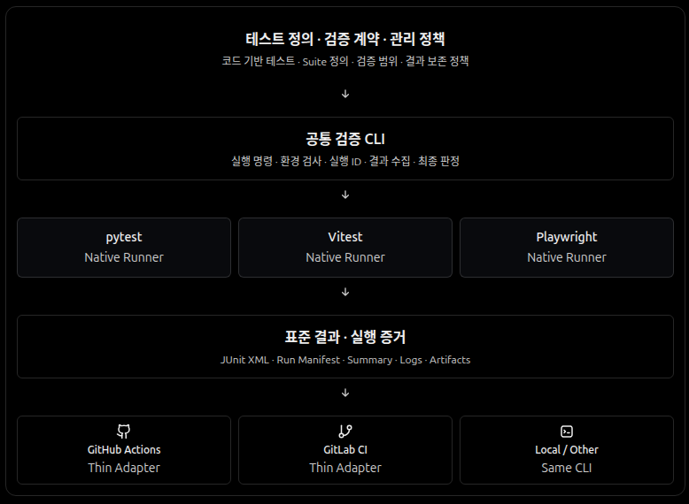

# 테스트·검증·CI

## 목적

SOS 검증은 제품 계약에서 발견할 가치가 있는 실제 실패를 확인하기 위한 것이다. 검증이 완전하지 않은 상태를 허용하되 미실행을 성공으로 표현하지 않는다.

## 책임 구조



- **검증 계약·정책:** 제품 책임에서 무엇을, 왜, 언제 확인할지 결정한다. 별도 테스트 등록부를 만들지 않는다.
- **공통 CLI:** `scripts/validate.py`가 Suite를 선택하고 Native Runner를 호출하며 종료 코드를 전달한다.
- **Native Runner:** pytest가 Python 테스트의 수집·실행·성공 판정을 담당한다. Web 검증은 npm 스크립트로 직접 실행한다.
- **결과·증거:** 현재는 종료 코드와 출력 로그를 사용한다. JUnit·Run Manifest·Artifacts는 실제 소비 요구가 생기면 필요한 만큼만 생성한다.
- **Thin Adapter:** 로컬·GitHub Actions는 동일한 CLI를 호출한다. 다른 CI 제공자는 실제로 필요할 때 연결한다.

## 현재의 유효한 검증

```bash
python scripts/validate.py list
python scripts/validate.py run python
python scripts/validate.py run all
# 또는 make validate
```

현재 `python` Suite는 `tests/`의 Python 테스트를 pytest로 자동 수집·실행한다. 구체적인 검증 범위는 실제 테스트 코드와 실행 결과를 따른다.

웹은 `cd web && npm run test:navigation`(URL·결과 문맥 렌더링)과 `npm run build`(TypeScript·Vite 빌드)로 검증하며 CI의 `web-build`가 같은 명령을 실행한다. 자동 검증에는 실제 브라우저·API·Worker·저장소·MLflow 통합 실행이 포함되지 않는다.

Feast 전용 SDK가 필요한 변경을 확인할 때에는 필요에 따라
`uv run --locked --group dev --group feast pytest -q tests/test_feast_live.py`를 실행한다.
이는 상시 CI에 별도 Runtime 설치·Docker Compose 기동을 강제하지 않는 선택적 집중 검사다.
전체 Compose 통합 실행은 필요한 변경에서 별도 Compose 프로젝트로 수행하고 결과는 PR에 남긴다.
일회성 서비스 기동 시나리오는 제품 테스트 코드로 보관하지 않는다.

`all`은 **현재 CLI에 등록된 Suite 전체**라는 뜻이지 SOS 제품 계약 전체를 뜻하지 않는다. pytest가 테스트를 수집하지 못해 비정상 종료하면 CLI도 실패한다. CI의 `validation` 상태도 이 범위에만 해당한다.

## 변경 방식

새 검증은 (1) 발견하려는 구체적인 실패, (2) 실제 판정 결과가 바꾸는 판단, (3) 가장 낮은 실행·환경·유지·진단 비용을 기준으로 추가한다. Python 테스트는 pytest가 자동으로 수집하므로 테스트별 중앙 등록은 필요 없다. 다른 Runner가 필요해질 때 CLI의 간단한 Suite 명령 매핑만 확장한다.

사용되지 않는 증거·관리 계층을 구현하지 않으며 테스트 삭제에 별도 승인 제도를 두지 않는다. 실행한 검증과 미실행 위험은 PR에 명시한다.
