# SOS Machine Learning Platform — Platform Identity

> **Explore · Experiment · Understand · Evolve**
>
> 연구, ML 실행, 외부 서비스 활용을 연결하는 확장 가능한 머신러닝 플랫폼.

## 1. 제품 정체성

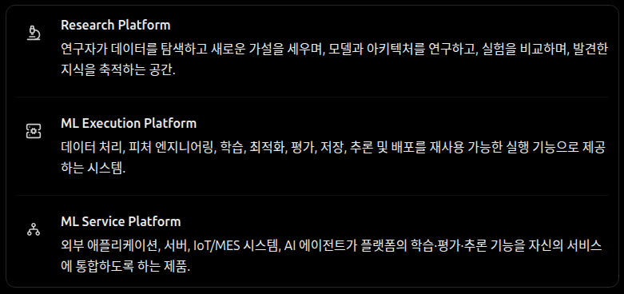

| 영역 | 제공 가치 |
| --- | --- |
| **Research Platform** | 데이터 탐색, 가설·모델·아키텍처 연구, 실험 비교 및 연구 지식 축적 |
| **ML Execution Platform** | 데이터 처리, 피처 엔지니어링, 학습, 최적화, 평가, 모델 관리, 추론·배포 |
| **ML Service Platform** | 외부 애플리케이션, 서버, IoT/MES 시스템, AI 에이전트에 ML 기능 제공 |

### 운영 중심의 제품 가치

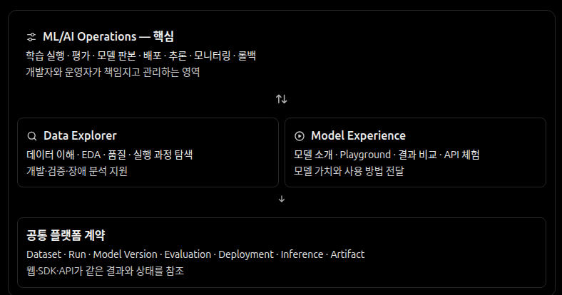

SOS의 중심 책임은 **모델의 실행·평가·불변 판본·배포·추론·관측과 변경 이력을 신뢰성 있게 관리하는 것**이다. Data Explorer는 데이터 이해와 개발·평가·운영 중의 조사를 지원하고, Model Experience는 모델의 동작·평가 근거·사용 방법을 체험할 수 있게 한다. 이 세 경험은 순서대로 거치는 단계가 아니라 **같은 플랫폼 계약을 공유하는 상호 연결된 능력**이다.

연구자는 SOS 밖에서 작성·실행한 코드와 모델도 가져올 수 있다. SOS는 특정 연구 UI나 학습 프레임워크를 강요하지 않으며, 연결된 실행·모델·평가·배포의 근거를 제공한다. 이는 장기 제품 방향으로, 현재 모든 학습·서빙·관측 기능이 구현됐음을 의미하지 않는다.

### 플랫폼의 기능적 책임 영역

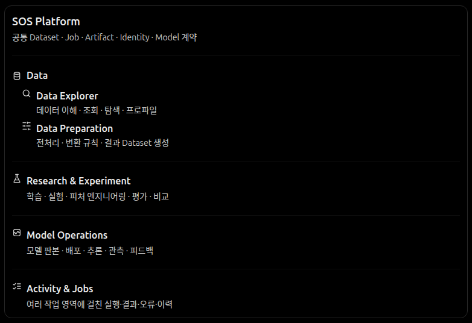

그림은 Research Platform·ML Execution Platform·ML Service Platform이라는 제품 정체성을 대체하지 않는다. 공통 계약 위에서 Data Explorer·Data Preparation, 연구·실험, 모델 운영, 작업·이력 관리가 맡는 **기능적 책임**을 설명한다. 고정된 화면 메뉴, 독립 서비스의 수, 필수 실행 순서 또는 현재 기능 구현 완료를 의미하지 않는다.

### 공통 접근·독립 기능·선택적 조합

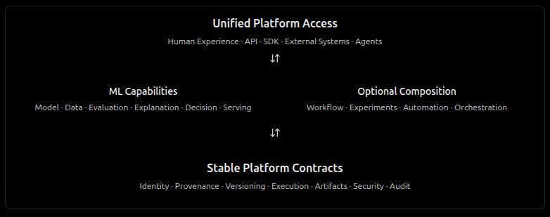

접근 경험이 달라도 Web UI·API·SDK·외부 시스템·에이전트는 같은 식별·권한·실행·결과 계약을 활용한다. 데이터·모델·점수 산출·평가·판정·설명·서빙은 필요한 능력을 독립적으로 제공하고, **Workflow·실험 묶음·자동화는 선택적으로 연결한다**. Experiment는 연구 목적의 논리적 묶음이며 모든 Job의 필수 실행 단계가 아니다.

이 그림은 **개념적 책임 구조**로, 고정된 서비스 배치·호출 순서·필수 Workflow나 현재 모든 기능의 구현 완료를 의미하지 않는다. 계약의 안정성은 의미와 호환성에 관한 원칙이며 기술·API 필드를 영구적으로 고정하지 않는다. 기능별 공통화 범위는 [Contracts](../contracts.md#ml-기능별-책임과-공통화-경계)를 따른다.

## 2. Data Explorer — 데이터 이해와 탐색

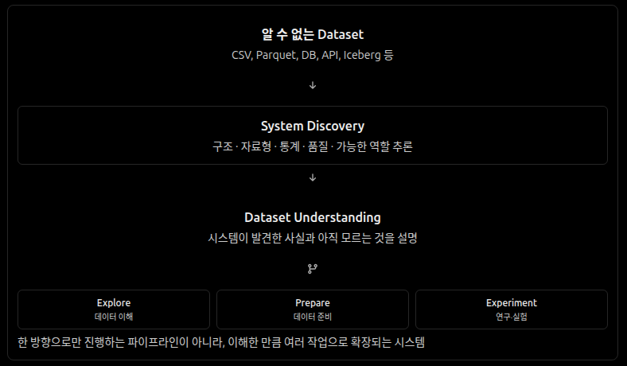

Dataset Understanding은 **Data Explorer에서 처음 보는 데이터를 이해하는 진입 경험**의 예시다. 사전 데이터 사전이나 특정 ML 시나리오가 없어도 지원 가능한 Dataset의 구조와 검증 가능한 특성을 발견할 수 있어야 한다. 계산으로 확인한 사실, 해석이 필요한 역할 후보, 확인되지 않은 업무적 의미를 구별하고 원본을 변경하지 않는다.

데이터 이해만으로도 작업이 완결될 수 있으며 탐색·준비·실험은 선택적으로 연결된다. 그림의 Explore · Prepare · Experiment는 필수 파이프라인이 아니다. 학습·배포나 외부에서 개발된 모델의 운영은 Dataset Understanding 없이도 시작할 수 있다. 분석 근거와 데이터 판본을 보존하며 사람과 API 클라이언트에 동일한 계약을 제공한다. 모든 데이터 형식과 업무 의미를 자동으로 이해한다고 약속하지 않는다.

### 데이터 경험의 책임 경계

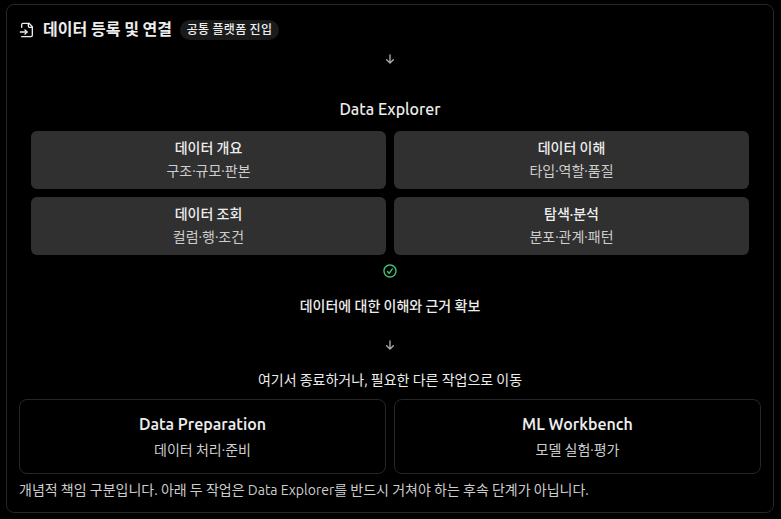

이 세 영역은 연산의 종류나 필수 단계가 아니라 **사용자의 목적과 결과물**로 구분한다. Data Explorer는 구조·분포·관계·품질을 이해하고 탐색 근거를 검증하는 경험, Data Preparation은 분석·연동·ML 등 여러 목적에 맞게 데이터를 가공하는 경험이다. Feature Engineering은 모델의 학습·추론 입력과 시간적 정합성을 설계하는 경험이다. 탐색을 위한 임시 계산이 곧 새로운 Dataset 생성이나 모델 입력 정의를 뜻하지 않는다.

### Data Explorer의 완결성과 선택적 연결

데이터 등록·연결은 플랫폼 공통 진입 기능이다. Explorer에서 데이터에 대한 이해와 근거를 얻은 뒤 **다른 작업 없이 종료할 수 있다**. Data Preparation과 ML Workbench는 Explorer를 거치지 않고도 데이터 참조에서 직접 시작할 수 있는 독립 영역이다. 그림은 목표 경험의 개념도이며 화면 구성을 고정하거나 미구현 기능을 구현된 것으로 표현하지 않는다.

## 3. 지속적 개선 과정

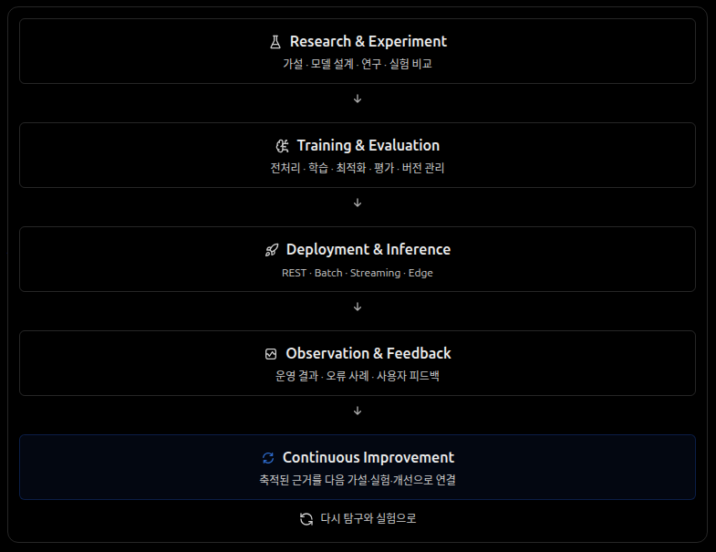

- **Research & Experiment:** 가설, 모델 설계, 연구, 실험 비교
- **Training & Evaluation:** 전처리, 학습, 최적화, 평가, 버전 관리
- **Deployment & Inference:** REST, Batch, Streaming, Edge
- **Observation & Feedback:** 운영 결과, 오류 사례, 사용자 피드백
- **Continuous Improvement:** 축적된 근거를 새로운 탐구·실험·개선에 반영

각 과정은 독립적으로 활용 가능하며 고정된 순서를 강제하지 않는다.

## 4. 연구 경험

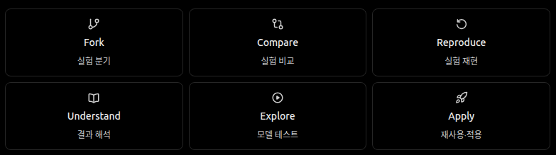

| 기능 | 사용자 행동 |
| --- | --- |
| **Fork** | 이전 실험을 기반으로 새로운 실험 생성 |
| **Compare** | 설정, 데이터, 모델, 결과의 차이 비교 |
| **Reproduce** | 기록된 조건으로 실험 재현 |
| **Understand** | 실험 결과와 변화 원인 탐색 |
| **Explore** | 모델의 동작을 직접 테스트 |
| **Apply** | 연구 결과를 재사용하고 다른 환경에 적용 |

성공한 실험뿐 아니라 실패한 실험의 조건과 결과도 이후 연구에 활용할 수 있도록 보존한다. 이는 웹 화면 안에서 코드를 작성하거나 모든 연구 단계를 직접 수행하도록 강제한다는 뜻이 아니다.

## 5. 플랫폼 접근

- **Human:** Web UI, Playground
- **External App:** API, SDK, Events
- **AI Agent:** API, Tools

Human은 개발·운영과 모델 탐색·체험을 포함하는 접근 방식이며 영구적인 사용자 유형 구분이 아니다. 학습·평가·모델 관리·추론 등 핵심 기능은 특정 UI에 종속되지 않는다. 외부 시스템은 플랫폼을 통해 모델 학습을 요청하고, 등록된 모델을 사용하며, 운영 피드백을 전달할 수 있다.

## 6. 시스템 경계

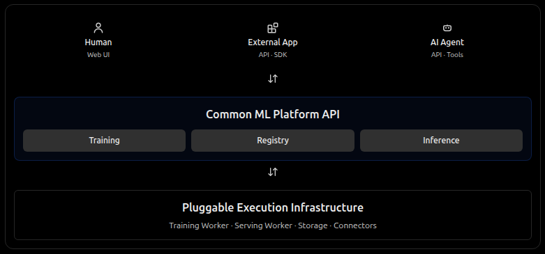

- **ML Platform:** 공통 프로젝트, 실행, 모델, 배포 API
- **Execution Infrastructure:** Training Workers, Serving Workers, Storage, Connectors
- **확장성:** 새로운 모델·알고리즘·학습 방식·프레임워크·실행 환경을 수용
- **재사용성:** 데이터 변환, 모델, 평가, 실행 결과, 배포 구성을 재사용 가능한 단위로 관리

플랫폼 개요 그림은 접근 경로와 제어·실행의 경계를 단순화해 표현한다. 데이터 준비부터 모델 배포까지를 하나의 필수 실행 순서나 고정된 화면 구성으로 규정하지 않는다.

## 7. 경험 중심 기능 개발

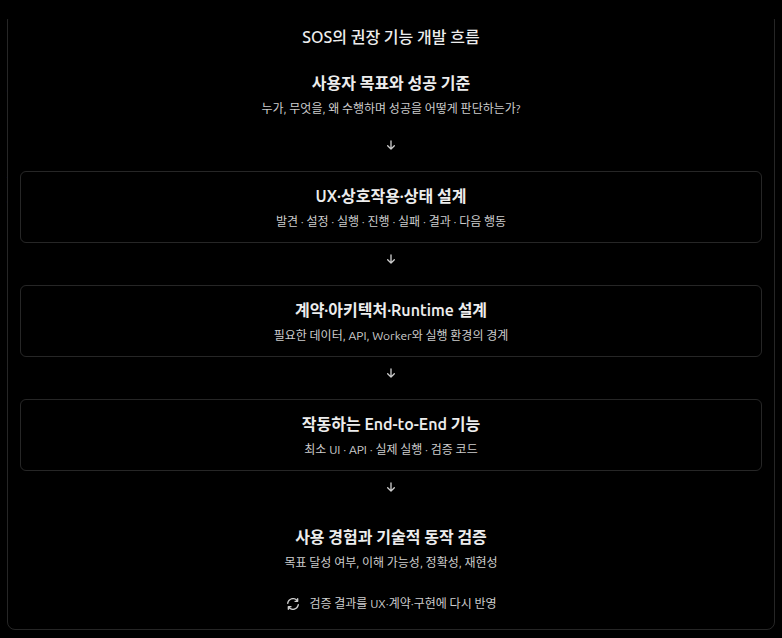

기능 개발은 **사용자 목표와 성공 기준**에서 출발한다. UX·상호작용·실행 상태를 설계하고, 이를 지원하는 계약·아키텍처·Runtime을 정의한 뒤 실제 기능과 사용자 경험을 함께 검증한다. 이 과정은 단방향 절차가 아니라, 구현과 검증에서 얻은 근거를 사용자 경험과 설계에 다시 반영하는 반복 과정이다.

## 공통 설계 철학

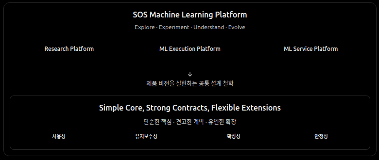

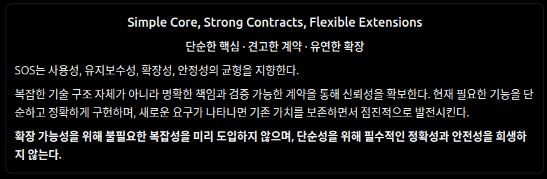

**Simple Core, Strong Contracts, Flexible Extensions — 단순한 핵심 · 견고한 계약 · 유연한 확장.** 이 철학은 세 가지 제품 정체성을 실현할 때 사용성·유지보수성·확장성·안정성의 균형을 판단하는 기준이다. 필수적인 정확성과 안전성은 지키되, 미래의 불확실한 요구만을 위한 추상화나 기술적 복잡성은 미리 도입하지 않는다. 특정 실행 명령이나 배포 기술을 플랫폼 계약으로 고정하지 않는다.

## 설계 기준

1. **사용자 가치:** 기술이나 라이브러리의 기능 자체보다 연구·실행·연동 경험을 우선한다.
2. **연구의 자유:** 현재 지원하는 모델 및 프레임워크가 새로운 접근법을 제한하지 않는다.
3. **연속성:** 데이터, 설정, 실험, 모델, 실행 환경 및 피드백의 관계를 추적하고 재현할 수 있도록 한다.
4. **API-first:** 웹 UI와 외부 시스템은 동일한 플랫폼 기능을 활용한다.
5. **분리와 재사용:** 플랫폼 기능과 실행 인프라를 분리하고, 컴포넌트를 다른 실험·서비스에서도 활용할 수 있게 한다.
6. **지속적 진화:** 새로운 근거와 기술에 따라 구현과 사용자 경험을 개선한다.
7. **운영 신뢰성:** 실행·평가 근거, 모델 판본과 배포 상태를 구별하고 실패·관측·복구를 운영 경험의 일부로 다룬다.

이 문서는 **제품 정체성과 설계 방향**을 정의한다. 특정 라이브러리, 모델 구조, 프레임워크 버전, 화면 구성 및 배포 기술을 고정하는 구현 명세가 아니다.
