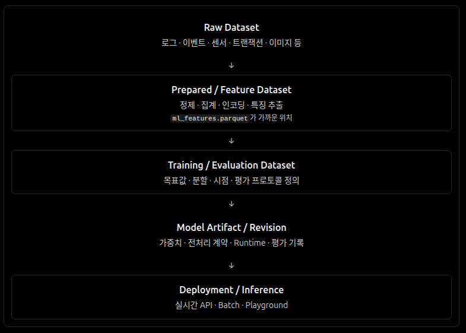

# 워크플로

SOS는 데이터 이해·가공·학습·평가·추론·관측을 필요한 만큼 독립 실행하거나 조합한다. 모두에게 하나의 선형 파이프라인을 요구하지 않는다.

신뢰된 등록형 Pipeline Run은 먼저 Worker 안에서 데이터 전체의 시간 분할을 확인한 뒤, 기존 ML Job의 확정 결과를 다음 단계의 입력으로 연결한다. API의 입력 구조 검사가 대규모 분석을 동기적으로 수행하거나 실제 학습 성공을 보장하는 것은 아니다. 실행자가 화면을 닫아도 Worker가 상태를 이어가며, 중복 제출은 멱등성으로 제한한다. Pipeline 취소 요청은 진행 중인 Job의 실제 중단·완료 확인과 구별한다.

## 실행 단위와 Job 상태

Workflow Definition은 작업 사이의 재사용 가능한 관계, Workflow Run은 그 실행 기록이다. **Job은 개별 실행 요청**, **Execution Attempt는 실제 수행 시도**이며 Workflow가 없는 Job도 가능하다. 식별자와 자산 판본의 의미는 [Contracts](contracts.md)가 정본이다.

| 상태 | 의미 |
| --- | --- |
| **Accepted** | 요청을 검증하고 작업을 접수·기록함 |
| **Queued** | 실행 자원 또는 스케줄링을 기다림 |
| **Running** | 실제 실행 시도가 시작됨 |
| **Succeeded** | 정해진 성공 조건을 충족하고 결과를 확정함 |
| **Failed** | 더 이상 Job이 성공하지 못하며 실패를 확정함 |
| **Cancelled** | 시작 전 취소 또는 실행 중단을 확인해 종료함 |

접수·취소 **요청**은 완료가 아니다. 취소와 완료의 경합에서는 실제 확정된 한 가지 결과를 일관되게 기록한다. 재시도는 새로운 Attempt이고, 사용자가 Fork·Reproduce를 선택하면 원래 Job의 입력과 연결된 **새 Job**을 만든다. 진행률은 측정 근거가 있을 때만 제공하며, 일부 결과나 오류가 확정 상태와 모순돼서는 안 된다.

## 독립 결과와 외부 전송

학습의 완료와 모델 평가의 신뢰성은 다르다. Model Revision·Scoring Result·정책·Evaluation·Explanation은 각자의 판본을 가지며 같은 점수에 다른 정책을 적용하더라도 재학습을 강제하지 않는다. 의미의 정본은 [Contracts](contracts.md)다.

MLflow Run과 Registry 등록은 ML Job과 별도로 `Pending → Sending → Succeeded / Retry` 상태를 가진다. 외부 등록 실패는 완료한 학습 성공을 뒤집지 않지만 새 모델 Scoring은 Registry 버전이 확인될 때까지 차단하고 Pipeline은 다음 단계로 넘어가지 않는다. 외부 시스템과 원자적 트랜잭션을 공유하지 않으므로 재시도에서 중복 Run/Model Version을 검사한다. 연결 구현은 [Runtimes](runtimes.md)를 따른다.

## 데이터·결과 게시와 복구

Dataset 등록은 원본 파일 객체의 무결성과 별도로 확정된다. PostgreSQL과 S3·Iceberg Catalog가 하나의 트랜잭션을 공유한다고 가정하지 않는다. Attempt의 결과는 다른 Attempt가 덮어쓰지 않도록 분리해 게시하고, 객체 업로드·DB 확정 사이에 실패가 나면 불확실한 데이터를 즉시 삭제하거나 성공으로 간주하지 않는다.

Worker는 실행 잠금의 소유권과 **현재 Running Attempt**를 확인한 경우에만 완료·결과 게시를 확정한다. 소유 PostgreSQL 세션이 커밋 전에 유실되면 **그 DB 트랜잭션의 변경만** 롤백되며, 이전 Attempt의 늦은 DB 결과 확정은 거부한다. 이미 수행된 S3 전송·Iceberg 커밋은 롤백된 것으로 간주하지 않는다. 중단된 일반 변환은 복구 후 다른 Attempt로 다시 실행할 수 있지만, 외부 저장소 커밋 여부가 불확실한 작업은 별도로 판단한다. 객체 보존 계약은 [ADR 0002](adr/0002-object-lifecycle.md)를 따른다.

**Iceberg Append는 외부 Snapshot 커밋**이다. 대기 중 취소는 가능하지만 현재 실행 중인 적재의 취소는 커밋 롤백을 보장하지 못하므로 거부한다. 중단된 작업은 자동 재적재하지 않고 Attempt 식별자와 Catalog Snapshot 근거를 대조한 뒤 별도로 처리한다. Snapshot Tag 보호 후 DB 게시가 실패했더라도 Tag를 제거하거나 재시도 성공을 추정하지 않는다. 보존 의도와 실제 Tag 확인은 [ADR 0003](adr/0003-snapshot-identity-audit.md)과 [Diagnostics](diagnostics.md)를 따른다.

Dataset 등록과 Understanding Profile 계산 역시 독립적인 사건이다. 프로파일 작업의 실패·취소가 원본의 유효성을 변경하지 않고, 성공한 분석 결과는 원본 판본에 연결된다.

## 연구와 서비스 연결

그림은 자산 간 가능한 참조 관계이지 필수 작업 순서나 현재 구현 완료를 뜻하지 않는다. 모델 등록은 배포와 다르며, 연구자는 저장된 데이터·모델·환경·평가 근거로 실험을 비교하고 재실행할 수 있어야 한다. 스케줄러·큐·DAG 엔진은 이 실행 의미를 구현하는 선택지이고, 사용자의 행동과 오류 안내는 [Experience](experience.md)를 따른다.
